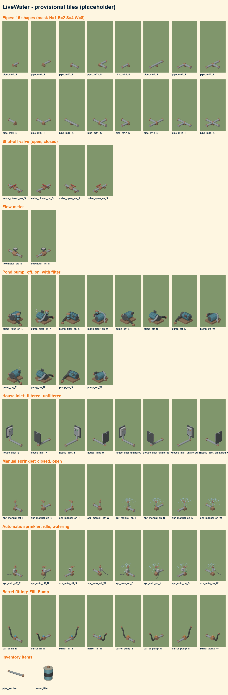
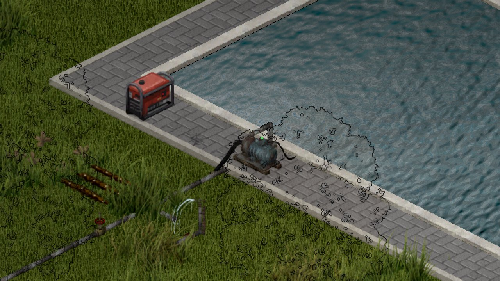
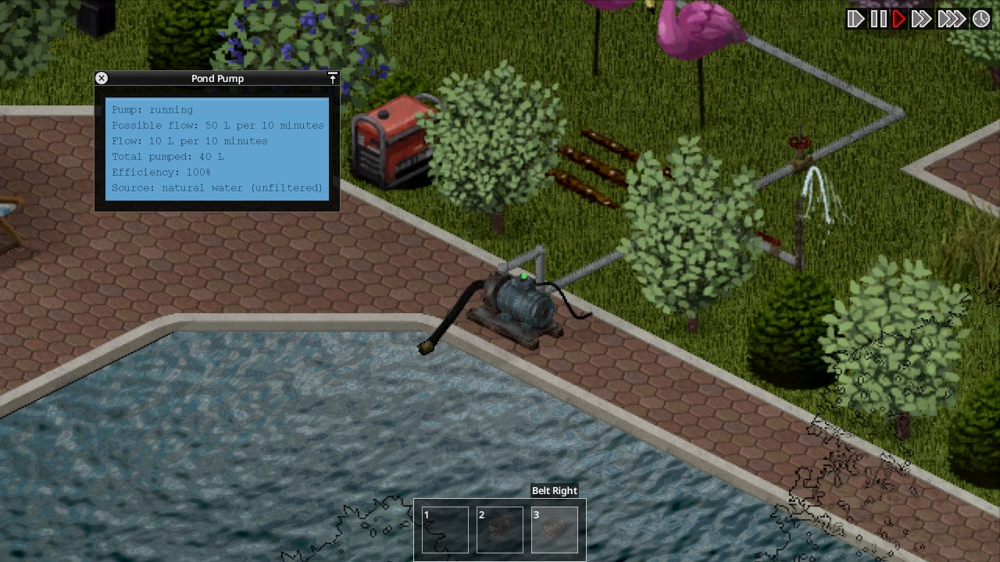
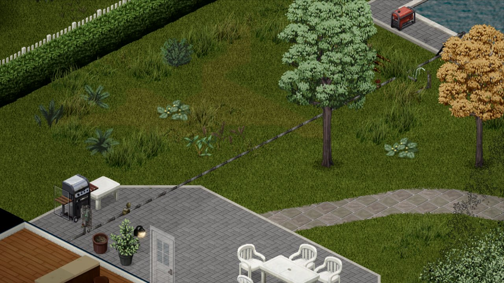
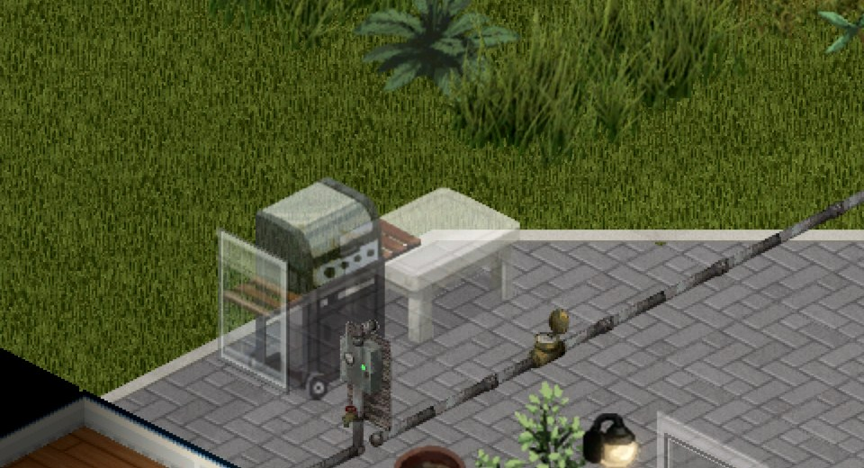
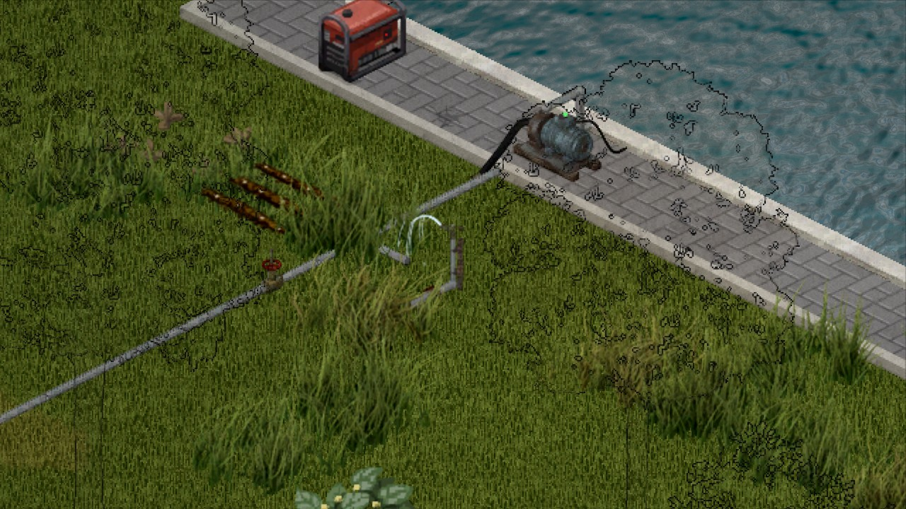
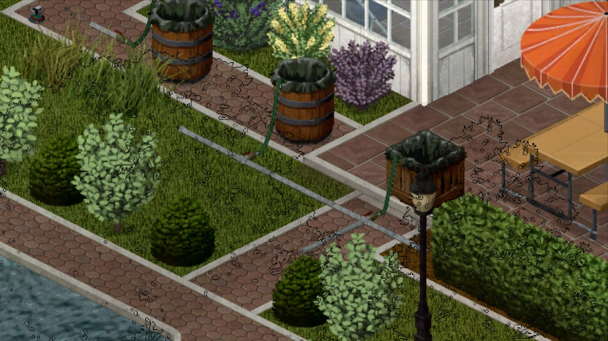
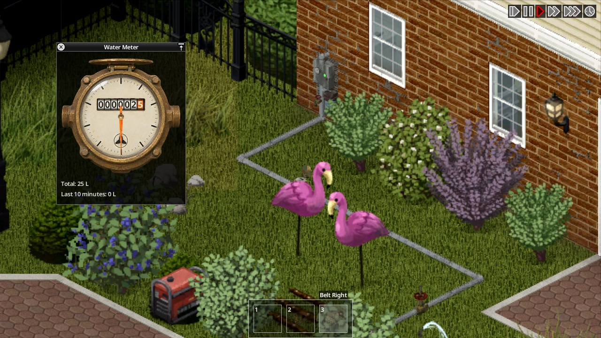

# Getting started

A LiveWater network always has the same shape: a **source** (a pond pump next to water, or a barrel), **pipes** set down
on the ground, and **outlets** at the other end (a house water inlet, sprinklers, drip lines, barrels to fill). Water
moves every 10 in-game minutes.

Every action from a LiveWater right-click menu walks you to the part and takes a few seconds, like the game's own
actions.

## 1. Cut water pipes

One water pipe covers one square. Recipe **Cut Pipe Sections**: 1 metal pipe, with a hacksaw (kept), gives
**4 water pipes**.

> Screenshot to do: the Cut Pipe Sections recipe in the crafting window.

## 2. Build the pond pump

Recipe **Build Pond Pump** (Electrical 2): 1 metal pipe, 2 small metal sheets, 3 electronics scrap, 2 electric wires,
4 screws, with a screwdriver and a wrench (kept). It gives a pond pump (15 kg) and 15 Electrical XP.

Set it down like furniture (right-click it in your inventory, Place) **right next to natural water**: a lake, a pond,
a river, or a well (see [Wells](#13-wells)). Anywhere else the cursor turns red: *Must stand next to natural water*.

The pump needs **power**: a generator or the public grid on its square, or LiveWire (see [LiveWire](04-livewire.md)).
It gives **50 L every 10 minutes** while something downstream needs water, and stops on its own otherwise. A pump that is
switched on and has power hums, even with no water asked for; the noise draws zombies only while it pumps.

Its right-click menu:

- **Turn Pump On** / **Turn Pump Off**: the switch, on top of the automatic stop.
- **Information**: a backlit LCD screen: state (running, on standby, switched off, no power, broken down), possible
  flow, flow of the last 10 minutes, total pumped since it was set down, efficiency, source. The screen updates while
  it is open.
- **Repair Pump**: see below.

**Wear.** Its efficiency drops while it runs (about a week of running from 100% to 0% with the default settings), and
the flow drops with it. Below 20% it may break down; at 0% it stops. Switch it off, then repair it with **2 scrap
metal** and a **wrench**: efficiency back to 100%.

A pump has 4 connections: up to 4 pipes can leave it. Its pressure is enough for **one house and four sprinklers**
(a house inlet counts 2, a sprinkler or a filling barrel counts 1, all the drip lines of the network together
count 1).

**While you are away.** Your water network keeps working when you go far from it: the pump still draws from its pond
or well, open sprinklers and drip lines still water the crops, and barrels set to Fill or Pump keep filling or
emptying (you find the right amount when you come back). The house inlet waits for your return. Power while you are
away: with LiveWire, the network that powers the pump's square; otherwise the public grid until its shut-off day,
and a generator counts as it was when you left (it burns no fuel meanwhile and picks up its consumption when you
return).

## 3. Set down the pipes

A water pipe is set down like every other part: right-click it in your inventory, **Place**, then put it down with the
furniture cursor. One pipe per square. Pipes join their neighbours and change shape on their own (straight, elbow, T, cross). Pipes stay on one level:
the house inlet carries the water to the upper floors and the basement.

Pipes pass under fences and gates (a dark sleeve shows where they cross), but not through a solid wall or a door.
To bring water into a building, use the house water inlet.

A pipe set down against the side of a water meter or an inline valve does not join it: both have two sides only, on
the axis they were set along.

**Network view.** Right-click a part and choose **Show the Water Network** to colour the whole network: pipes and pumps
in blue, outlets by state, and the house fixtures they feed (see [Diagnostics](03-diagnostics.md)). **Hide the Water
Network** turns it off; the two options are never shown together.

To take a pipe back, pick it up like the other parts, with a **wrench**. You get the pipe back.

## 4. Valves

**Shut-off valve.** Recipe **Build Shut-off Valve**: 1 water pipe, 1 scrap metal, with a pipe wrench (kept). Set it
down with the furniture cursor on an empty square between two pipes of a straight run (it takes the place of one pipe:
pick that pipe up first); it turns along the pipe on its own. It is set down open. Right-click it:
**Close the Valve** cuts the water to everything after it (the house, the sprinklers further on), **Open the Valve**
lets it through again; its handwheel shows the state, and **Information** says it too. Pick it up with a wrench like
the other parts.

Every sprinkler also has its own valve (**Open the Valve** / **Close the Valve**). A closed valve lets no water
through, and the diagnostics say so (*a valve is closed*). Sprinklers are set down closed.

An inline valve keeps its axis when you open or close it. Opening or closing a valve, inline or on a sprinkler, makes
a valve sound that nearby players hear.

## 5. House water inlet

Recipe **Build House Water Inlet**: 2 water pipes, 1 small metal sheet, 4 screws, with a pipe wrench (kept).

Set it down **against the outside wall** of a building of the map, and run a pipe to it from the pump. It feeds the
**sinks, bathtubs, showers, toilets and washing machines** of that building that you plumbed with a pipe wrench (the
game's own Plumb action), within **20 squares** (sandbox option), up to **3 floors above** it and **2 basement levels**
below.

Its light tells you what it does:

- **green**: clean water, the house gets it (a working filter in the inlet, or water from a well);
- **amber**: the water is **unfiltered**, the house gets **none** (fit a filter in the inlet, replace a worn-out one,
  or use a well).

A fixture already fed by something else (a LiveWire pump, a barrel above it) is left alone.

A sink, shower, bathtub, toilet or washing machine that this inlet feeds shows the water it holds in its right-click
menu, for example a greyed line **Water: 18 L / 25 L**.

## 6. Water filter

Pond and river water is not clean. Recipe **Make Water Filter**: 2 charcoal and 2 ripped sheets give a **water filter
cartridge**. It cleans about **500 L**; its condition shows what is left.

The filter goes in the **house water inlet**: right-click it, **Fit Water Filter**, **Replace Water Filter** or
**Remove Water Filter**. A cartridge taken out keeps its wear; a worn-out one is thrown away. The inlet shows the
filter canister under its box. It cleans only the water that enters the house: sprinklers, drip lines and barrels take
the network's water as it is and never wear the cartridge.

## 7. Sprinklers

**Manual sprinkler.** Recipe **Build Sprinkler**: 2 water pipes, 1 scrap metal, 1 plank, with a pipe wrench (kept).
Set it down like furniture and feed it with a pipe. Right-click: **Open the Valve**. Its lever shows the state at a
glance: along the pipe when open, across it when closed. While its valve is open it sprays
**10 L every 10 minutes**, whether the plants are thirsty or not. The living plants that need water in the
**5 × 5 square** around it (2 squares on each side; the sandbox option changes that reach) take 200 ml doses of it,
nearest first; the rest is lost. Any water does, clean or not. Close it once the garden is watered: left open, it
keeps emptying your barrel or running your pump.

To see which squares are watered, right-click a sprinkler or a drip line: **Show All Watered Areas** lights up in blue
the floor of every square watered by the sprinklers and drip lines within 25 squares of you; **Hide the Watered Area**
turns it off; only one of the two is offered at a time. Their
**Information** gives their flow: how many litres they use every 10 minutes (and, for a sprinkler, how many reach the
plants).

A watering sprinkler shows an animated water jet that turns all the way round (mod option *Animated sprinkler jet*:
untick it for a still jet on slow computers). A quarter of its water is lost in the air: of 10 L, 7.5 L can reach the
plants. One pond pump (50 L every 10 minutes) feeds up to five open sprinklers in full; the next ones get what is
left, then nothing. It is not silent either: you hear it water, and **zombies hear it** every 10 minutes
while it sprays. For a quiet garden that saves water, use [drip lines](#8-drip-lines).

**Automatic sprinkler.** Recipe **Add a Timer to a Sprinkler** (Electrical 2): 1 sprinkler, 2 electronics scrap,
1 electric wire, with a screwdriver (kept); 10 Electrical XP. It opens on its own **every 6 hours** and sprays for
**30 minutes** (10 L every 10 minutes), then closes. Change the interval from its right-click menu, **Watering Timer**, 1 to 24 hours (limits in the sandbox
options). The timer needs a little power (5 W: generator, grid or LiveWire); without power it does nothing, but you
can still open the valve by hand. A green light on the timer is on while the sprinkler waters.

## 8. Drip lines

A drip line is a thin brown hose laid on the ground between your rows. It waters the plants right beside it, quietly,
without wasting water.

**Make it.** Recipe **Make Drip Lines** (Farming): 1 rubber hose and 2 uses of duct tape, with a sharp knife (kept),
give **4 drip lines**. One drip line covers one square.

**Set it down** like a pipe: right-click it in your inventory, **Place**, one per square. Drip lines join each other and
the water pipes and change shape on their own. Pick one up by hand, no tool needed.

**What it waters.** Every 10 minutes, each square of the line takes **0.5 L** from the network and waters the squares
next to it that are not part of the line, 200 ml per dose. A straight line waters the squares on both sides; the
square under the hose itself is not watered. So lay the line in a path between two rows of crops. Nothing is lost in
the air; what the plants do not need soaks away. It drips whenever the network gives it water: put a
[valve](#4-valves) before it to stop it. A drip line at the far end of a network that ran out of
pressure stays dry.

**What it needs.**

- **Any water.** Clean or not, no filter needed. Gasoline or any other fluid is refused.
- **Little pressure.** All the drip lines of a network count as **1** together, whatever their number.
- **No pump needed.** Connect a barrel with a [barrel fitting](#9-barrel-fitting-fill-or-pump) set to **Pump**: with no
  pump on the network, the barrel's own weight pushes its water into the drip lines, rain or pond water alike.
  This weak pressure is only enough for drip lines: a sprinkler or a house inlet on that network gets nothing.

A drip line makes no sound.

## 9. Barrel fitting: Fill or Pump

Recipe **Build Barrel Fitting**: 1 water pipe, 1 rubber hose, with a pipe wrench (kept). Set it down between the end
of a pipe and a barrel or rain collector, or in the middle of a run of pipes, where it passes the water from one pipe
to the next. Its look follows the pipes around it (straight, bent, tee or cross); the barrel, when there is one, stays
behind it. Right-click it:

- **Set to Fill**: the pipes fill the barrel, up to 50 L every 10 minutes, never overflowing. The barrel always
  receives **tainted water**, even from a well: the pipes carry untreated water, only the house inlet gives clean
  water. A water cooler can be filled the same way.
- **Set to Pump**: the pump of the network draws the barrel instead of its pond. With no pump on the network, the
  barrel feeds [drip lines](#8-drip-lines) by its own weight.

Its look follows the mode, the shape of the collector and the pipes around it. **Information** shows the mode and the litres in the barrel.

**Gasoline.** A fitting set to Pump on a gasoline barrel or a gas station pump makes a gasoline network. It only fills
barrels (empty, or already holding gasoline) through fittings set to Fill. House inlets and sprinklers get nothing and
say so.

## 10. Barrels connected to the house

No pump? Right-click a rain collector or a barrel standing **inside the house or on its roof**: **Connect to the House
Water Inlet** (with a pipe wrench). No pipe is needed, only a house water inlet on that building.

- A barrel feeds **its own floor and the floors below** (gravity). With a pump on the inlet's network, or power on the
  barrel's square, it feeds every floor.
- All connected barrels drain **together**. **Keep in Reserve (used last)** sets one aside: it is used only once the
  others are empty. **Use With the Other Barrels** puts it back.
- An empty barrel stays connected. A barrel holding anything other than water gives nothing until it is emptied.
- **Disconnect from the House Water Inlet**, or carry the barrel away: it is no longer connected.

## 11. City water

While the city water still runs, right-click a sink, bathtub, shower, toilet or washing machine that **you set down**
inside a room of a building of the map: **Connect to the City Water**. It then works like the original fixtures:
unlimited water until the city water is cut off.

## 12. Water meter

Recipe **Build Water Meter**: 1 water pipe, 1 small metal sheet, 2 screws, with a screwdriver (kept). Set it down
inline on a pipe; it follows the pipe's direction and joins only the two pipes on its axis. **Information** opens a
meter window in the style of a US water meter: a roller counter with the litres that went through it since it was set
down (kept when you pick it up and set it down again; there is no reset), a sweep hand (one turn every 10 litres), the
litres of the last 10 minutes, and the fluid (clean water, unfiltered water or gasoline).

## 13. Wells

The same pond pump set down next to a **well** draws **clean water**: the house gets it without a filter. Its
Information says *Source: well (clean water)*.

> Screenshot to do: a pond pump next to a well.

## 14. Dismantle a part

Every LiveWater part can be dismantled in your inventory, with a recipe **Dismantle ...** (crafting window, Assembly
or Electrical): a pipe wrench or a wrench for the plumbing parts (pipe, valve, water meter, house inlet, sprinkler,
barrel fitting), a screwdriver for the pond pump and the automatic sprinkler, a knife for a drip line or a water
filter. You never get back more than the part cost, and only scrap: iron pieces, scrap metal, screws, electronics
scrap, wire. A water filter gives back a piece of cloth, a drip line a rubber band.

A part set down can also be dismantled where it stands, with the game's own **Disassemble** menu and the same tool
(Maintenance raises your chance for the plumbing parts, Electrical for the pump and the automatic sprinkler). It leaves
the network as if you had picked it up. A drip line is picked up by hand, then dismantled in the inventory.

## 15. Finding parts

Some parts can be found instead of built, rarely: water pipes, shut-off valves and barrel fittings in plumbing supplies
and tool crates, sprinklers, drip lines and water filters in garden stores and farming supplies. The pond pump, the
house inlet, the water meter and the automatic sprinkler are never found: you build them.

Next: [Player base](02-player-base.md) · [Diagnostics](03-diagnostics.md)
