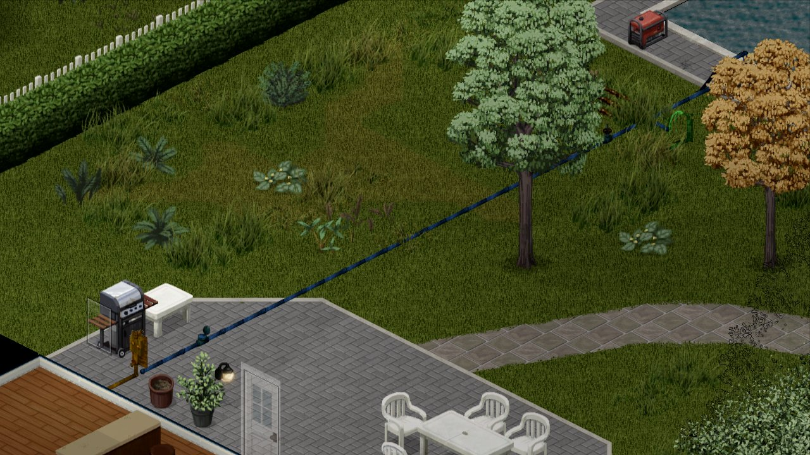
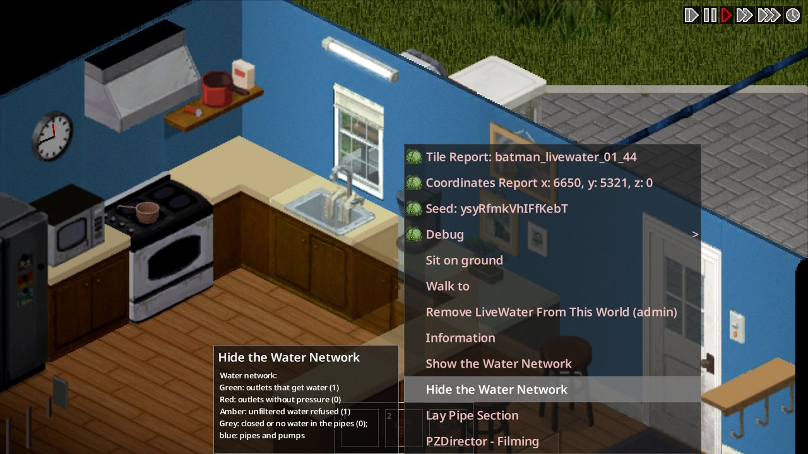
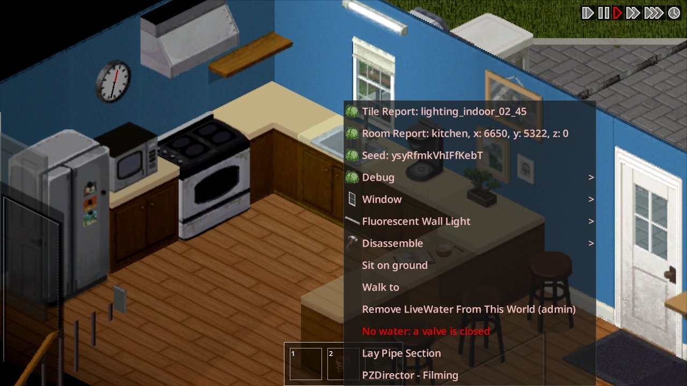

# Diagnostics

## Network view

Right-click any part of a network (pipe, pump, inlet, sprinkler, fitting): **Show the Water Network**. The whole
network is highlighted until you choose **Hide the Water Network**:

| Colour | Meaning |
|---|---|
| green | outlets that get water |
| red | outlets without enough pressure |
| amber | outlets that refuse unfiltered water (a house inlet without a working filter) |
| grey | closed, or no water in the pipes |
| blue | pipes and pumps |

The fixtures of the house in the area of each house inlet of the network (sinks, showers, bathtubs, toilets,
washing machines) are highlighted too:

| Colour | Fixture |
|---|---|
| green | connected to the house inlet, with water |
| red | connected to the house inlet, but dry |
| amber | not plumbed (use a pipe wrench on it) |
| grey | fed by something else (a Live Wire pump) |

The tooltip of *Hide the Water Network* counts the outlets and the fixtures in each state.

## Information lines

**Information** in the right-click menu of a part shows what it does:

- pump: a backlit LCD screen with its state, possible flow, flow of the last 10 minutes, total pumped, efficiency
  and source (natural water or well);
- house inlet: filter left (or none, or worn out);
- house inlet: *delivered to the house*, *the house tanks are full*, *none in the pipes*, *unfiltered*, *not enough
  pressure*, *shut off*, or *the pipes carry gasoline*;
- sprinkler: watering, nothing to water, no water, unfiltered (sprinklers accept it), no pressure, valve closed; the
  timer interval and whether it has power;
- barrel fitting: mode (Fill or Pump), litres in the barrel, and what it is doing;
- water meter: total since it was set down, litres in the last 10 minutes and water quality, in a meter window.

## Why a tap has no water

Right-click a sink, bathtub, shower, toilet or washing machine that has no water: a line **No water: ...** says why. A fixture fed by a house inlet that has water shows a grey line **Water: 18 L / 25 L**.

| Reason shown | What to do |
|---|---|
| not plumbed yet | use a pipe wrench on it (the game's Plumb action) |
| no house water inlet serves it | set an inlet on this building, or move closer (range, floors) |
| its tank belongs to something else, and it is empty | another system (a LiveWire pump) feeds it |
| the water is on its way | wait up to 10 minutes |
| the water is unfiltered: fit a filter in the house water inlet | fit or replace the filter in the house water inlet, or pump from a well |
| not enough pressure | fewer outlets on that pump, or a second pump |
| no water in the pipes | the pump is off, broken down or without power |
| a valve is closed | open it |
| not enough pressure in the pipes (house inlet without a pump) | pipe a pump to the inlet |
| the pipes carry gasoline | this network moves gasoline, not water |

Next: [LiveWire](04-livewire.md)
