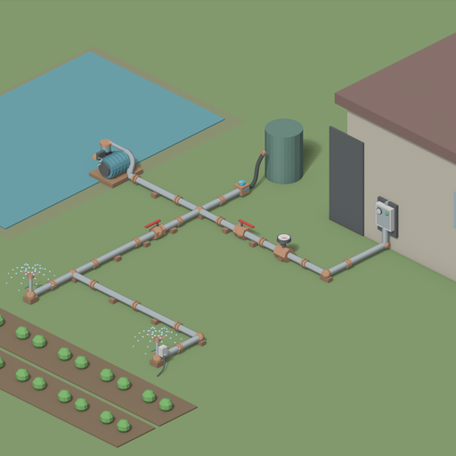
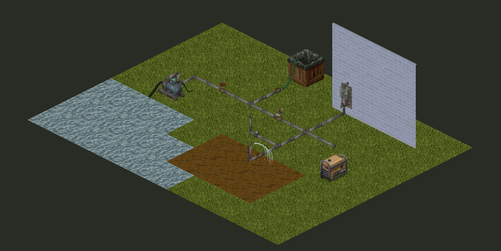

> Version française : [Accueil](../fr/Home.md)

# LiveWater

**LiveWater** (mod id `batman_LiveWater`) is a Project Zomboid **Build 42.22** mod. The
taps run dry one day; LiveWater lets you bring the water back yourself: a pond pump next to a lake, a river or a well,
pipes you set down on the ground, a house water inlet that feeds the sinks, showers, toilets and washing machines, barrels
that fill or feed the network through a barrel fitting, and sprinklers and drip lines that water the crops on their own.

LiveWire is optional: with LiveWire the pump becomes one of its consumers. Singleplayer and multiplayer (multiplayer
not tested yet).

New here? Start with [Getting started](01-getting-started.md).

## Pages

- [Getting started](01-getting-started.md): every part, from the first water pipe to the automatic sprinkler and the drip line.
- [Player base](02-player-base.md): running water in a base you built yourself.
- [Diagnostics](03-diagnostics.md): the network view, the Information lines and why a tap has no water.
- [LiveWire](04-livewire.md): the optional integration with LiveWire.
- [Sandbox options](05-sandbox-options.md): every server setting.
- [For modders](06-for-modders.md): the public API and its revisions.
- [Removing the mod](07-removing-the-mod.md): how to take LiveWater out of a world.
- [Multiplayer](08-multiplayer.md): what to know on a server.
