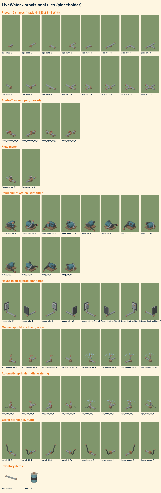

# Premiers pas

Un réseau LiveWater a toujours la même forme : une **source** (une pompe d'étang au bord de l'eau, ou un baril), des
**tuyaux** posés au sol, et des **sorties** au bout (une arrivée d'eau de maison, des arroseurs, des barils à remplir).
L'eau avance toutes les 10 minutes de jeu.

Chaque action d'un menu de LiveWater vous fait marcher jusqu'à la pièce et dure quelques secondes, comme les actions
du jeu.

## 1. Couper des sections de tuyau

Une section de tuyau couvre une case. Recette **Couper des sections de tuyau** : 1 tuyau en métal, avec une scie à
métaux (gardée), donne **4 sections de tuyau**.

> Capture à faire : la recette « Couper des sections de tuyau » dans la fenêtre d'artisanat.

## 2. Fabriquer la pompe d'étang

Recette **Fabriquer une pompe d'étang** (Électricité 2) : 1 tuyau en métal, 2 petites plaques en métal, 3 pièces
électroniques, 2 fils électriques, 4 vis, avec un tournevis et une clé à molette (gardés). Elle donne une pompe d'étang
(15 kg) et 15 XP d'Électricité.

Posez-la comme un meuble (clic droit dans l'inventaire, Placer) **juste au bord d'une eau naturelle** : lac, étang,
rivière, ou contre un puits (voir [Puits](#12-puits)). Ailleurs, le curseur passe au rouge : *Doit être posée au bord
d'une eau naturelle*.

La pompe a besoin de **courant** : un générateur ou le réseau public sur sa case, ou LiveWire (voir
[LiveWire](04-livewire.md)). Elle donne **50 L toutes les 10 minutes** tant qu'une sortie a besoin d'eau, et s'arrête
seule sinon. Une pompe en marche ronronne, et ce bruit attire les zombies.

Son menu au clic droit :

- **Allumer la pompe** / **Éteindre la pompe** : l'interrupteur, en plus de l'arrêt automatique.
- **Informations** : état (en marche, en attente, éteinte, sans courant, en panne), débit, rendement, filtre, source.
- **Réparer la pompe** : voir plus bas.

**Usure.** Son rendement baisse quand elle tourne (environ une semaine de marche de 100 % à 0 % avec les réglages par
défaut), et le débit suit. Sous 20 %, elle peut tomber en panne ; à 0 %, elle s'arrête. Éteignez-la, puis réparez-la
avec **2 ferrailles** et une **clé à molette** : rendement remis à 100 %.

Une pompe a 4 départs : jusqu'à 4 tuyaux peuvent en partir. Sa pression suffit pour **une maison et quatre arroseurs**
(une arrivée d'eau compte 2, un arroseur ou un baril à remplir compte 1).

> Capture à faire : une pompe d'étang en marche au bord d'une rivière, avec ses informations.

## 3. Poser les tuyaux

Avec des sections de tuyau dans l'inventaire, clic droit sur une case libre du sol : **Poser : Section de tuyau**.
Une section par case. Les tuyaux se raccordent à leurs voisins et prennent seuls leur forme (droit, coude, T, croix).
Les tuyaux restent sur un seul niveau : l'arrivée d'eau porte l'eau aux étages et au sous-sol.

Pour reprendre un tuyau : clic droit dessus, **Démonter : Section de tuyau**, avec une **clé anglaise** (la clé à
tuyau du jeu). La section vous est rendue.

> Capture à faire : une ligne de tuyaux depuis la pompe, avec un coude et un T.

## 4. Vannes

**Vanne d'arrêt.** Recette **Fabriquer une vanne d'arrêt** : 1 section de tuyau, 1 ferraille, avec une clé anglaise
(gardée). Posez-la au curseur de meuble sur une case vide entre deux tuyaux d'une ligne droite (elle prend la place
d'une section de tuyau : démontez d'abord cette section) ; elle se tourne seule dans le sens du tuyau. Elle se pose
ouverte. Clic droit dessus : **Fermer la vanne** coupe l'eau de tout ce qui est après elle (la maison, les arroseurs
plus loin), **Ouvrir la vanne** la laisse repasser ; son volant montre l'état, et **Informations** le dit aussi. Elle
se ramasse à la clé comme les autres pièces.

Chaque arroseur a aussi sa vanne (**Ouvrir la vanne** / **Fermer la vanne**). Une vanne fermée ne laisse passer aucune
eau, et le diagnostic le dit (*une vanne est fermée*). Les arroseurs se posent fermés.

## 5. Arrivée d'eau de la maison

Recette **Fabriquer une arrivée d'eau de maison** : 2 sections de tuyau, 1 petite plaque en métal, 4 vis, avec une clé
anglaise (gardée).

Posez-la **contre le mur extérieur** d'un bâtiment de la carte, et amenez-y un tuyau depuis la pompe. Elle alimente les
**éviers, baignoires, douches, toilettes et lave-linge** de ce bâtiment que vous avez raccordés à la clé anglaise
(l'action « Raccorder » du jeu), dans un rayon de **20 cases** (option sandbox), jusqu'à **3 étages au-dessus** et
**2 niveaux de sous-sol** en dessous.

Son voyant dit ce qu'elle fait :

- **vert** : eau propre, la maison la reçoit ;
- **ambre** : l'eau de la pompe n'est **pas filtrée**, la maison n'en reçoit **pas** (montez un filtre, ou pompez dans
  un puits).

Un point d'eau déjà alimenté par autre chose (une pompe de LiveWire, un baril au-dessus) est laissé tel quel.

> Capture à faire : l'arrivée d'eau contre un mur, voyant vert, et un évier où l'eau coule.

## 6. Cartouche filtrante

L'eau d'un étang ou d'une rivière n'est pas propre. Recette **Fabriquer une cartouche filtrante** : 2 charbons de bois
et 2 tissus déchirés donnent une **cartouche filtrante**. Elle nettoie environ **500 L** ; son état montre ce qui reste.

Clic droit sur la pompe : **Monter la cartouche filtrante**, **Remplacer la cartouche filtrante** ou **Retirer la
cartouche filtrante**. Une cartouche retirée garde son usure ; une cartouche usée est jetée. La pompe montre le filtre
sur sa tuile.

## 7. Arroseurs

**Arroseur manuel.** Recette **Fabriquer un arroseur** : 2 sections de tuyau, 1 ferraille, 1 planche, avec une clé
anglaise (gardée). Posez-le comme un meuble et alimentez-le par un tuyau. Clic droit : **Ouvrir la vanne**. Toutes les
10 minutes, il arrose les plantes vivantes qui ont besoin d'eau dans un rayon de **2 cases** (option sandbox), par
doses de 200 ml prises dans les tuyaux. L'eau non filtrée convient aux plantes. Un arroseur qui arrose montre un jet
d'eau animé (option du mod *Jet des arroseurs animé* : décochez-la pour un jet fixe sur un ordinateur lent).

**Arroseur automatique.** Recette **Ajouter une minuterie à un arroseur** (Électricité 2) : 1 arroseur, 2 pièces
électroniques, 1 fil électrique, avec un tournevis (gardé) ; 10 XP d'Électricité. Il s'ouvre seul **toutes les
6 heures**, arrose les plantes, puis se referme. Changez l'intervalle au clic droit, **Minuterie d'arrosage**, de 1 à
24 heures (bornes dans les options sandbox). La minuterie a besoin d'un peu de courant (5 W : générateur, réseau public
ou LiveWire) ; sans courant elle ne fait rien, mais vous pouvez toujours ouvrir la vanne à la main.

> Capture à faire : un arroseur automatique qui arrose un potager, jet visible.

## 8. Raccord de baril : Remplir ou Pomper

Recette **Fabriquer un raccord de baril** : 1 section de tuyau, 1 tuyau en caoutchouc, avec une clé anglaise (gardée).
Posez-le entre le bout d'un tuyau et un baril ou un récupérateur d'eau de pluie. Clic droit :

- **Régler sur Remplir** : les tuyaux remplissent le baril, jusqu'à 50 L toutes les 10 minutes, sans jamais déborder.
  Une fontaine à eau se remplit de la même façon, avec de l'eau propre seulement.
- **Régler sur Pomper** : la pompe du réseau tire le contenu du baril au lieu de son étang.

Son dessin suit le mode et la forme du récupérateur. **Informations** montre le mode et les litres du baril.

**Essence.** Un raccord réglé sur Pomper contre un baril d'essence ou une pompe de station-service fait un réseau
d'essence. Il ne remplit que des barils (vides, ou contenant déjà de l'essence) par des raccords réglés sur Remplir.
Arrivées d'eau et arroseurs ne reçoivent rien et le disent.

## 9. Barils raccordés à la maison

Pas de pompe ? Clic droit sur un récupérateur d'eau de pluie ou un baril posé **dans la maison ou sur son toit** :
**Raccorder à l'arrivée d'eau de la maison** (avec une clé anglaise). Aucun tuyau n'est nécessaire, seulement une
arrivée d'eau sur ce bâtiment.

- Un baril alimente **son étage et ceux du dessous** (gravité). Avec une pompe dans le réseau de l'arrivée d'eau, ou du
  courant sur la case du baril, il alimente tous les étages.
- Tous les barils raccordés se vident **ensemble**. **Garder en réserve (pris en dernier)** en met un de côté : il
  n'est utilisé qu'une fois les autres vides. **Utiliser avec les autres barils** le remet avec eux.
- Un baril vide reste raccordé. Un baril qui contient autre chose que de l'eau ne donne rien tant qu'il n'est pas vidé.
- **Débrancher de l'arrivée d'eau de la maison**, ou emportez le baril : il n'est plus raccordé.

## 10. Réseau public

Tant que l'eau de la ville coule, clic droit sur un évier, une baignoire, une douche, des toilettes ou un lave-linge
**que vous avez posé** dans une pièce d'un bâtiment de la carte : **Raccorder au réseau public**. Il se comporte alors
comme un point d'eau d'origine : eau illimitée jusqu'à la coupure de l'eau de la ville.

## 11. Compteur d'eau

Recette **Fabriquer un compteur d'eau** : 1 section de tuyau, 1 petite plaque en métal, 2 vis, avec un tournevis
(gardé). Posez-le en ligne sur un tuyau ; il suit le sens du tuyau. **Informations** montre les litres passés pendant
les 10 dernières minutes, et le fluide (eau propre, eau non filtrée ou essence).

## 12. Puits

La même pompe d'étang posée contre un **puits** tire de l'**eau propre** : la maison la reçoit sans filtre. Ses
informations disent *Source : puits (eau propre)*.

> Capture à faire : une pompe d'étang contre un puits.

Suite : [Base du joueur](02-base-du-joueur.md) · [Diagnostic](03-diagnostic.md)
