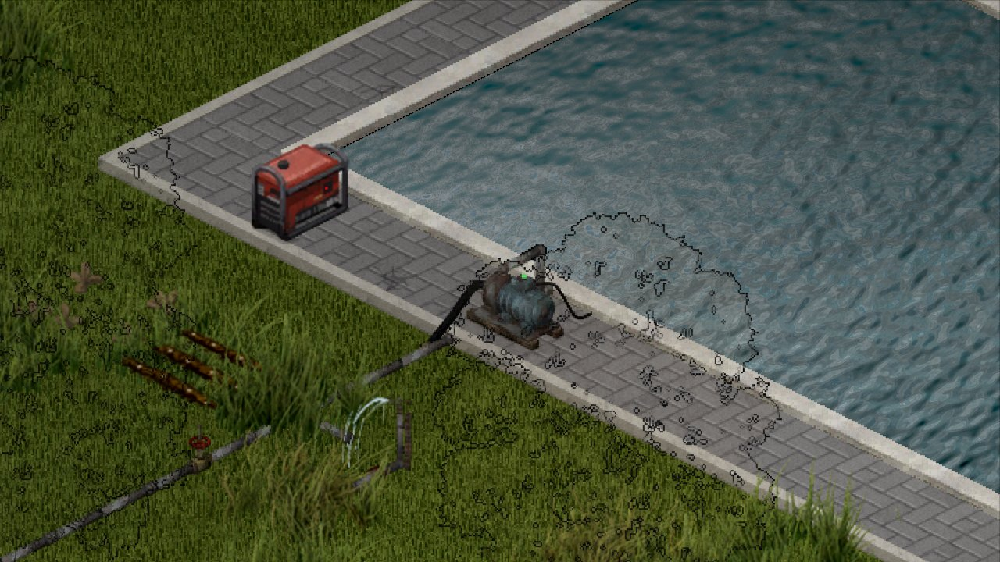
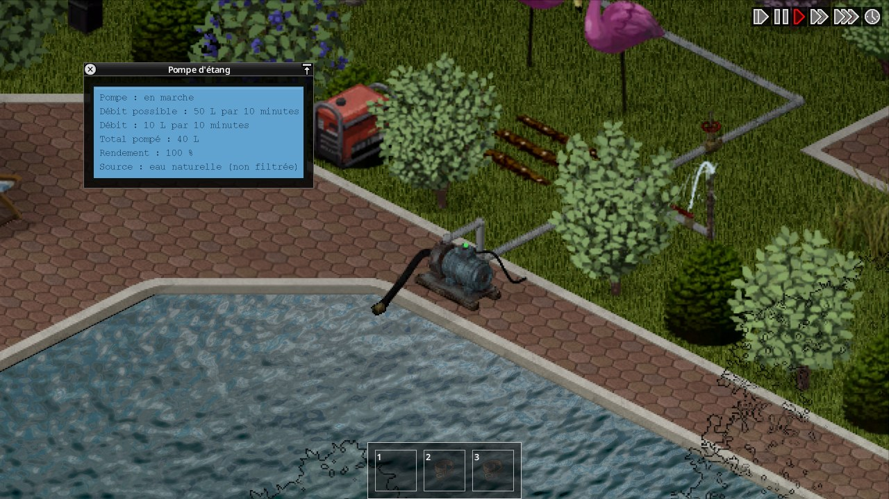
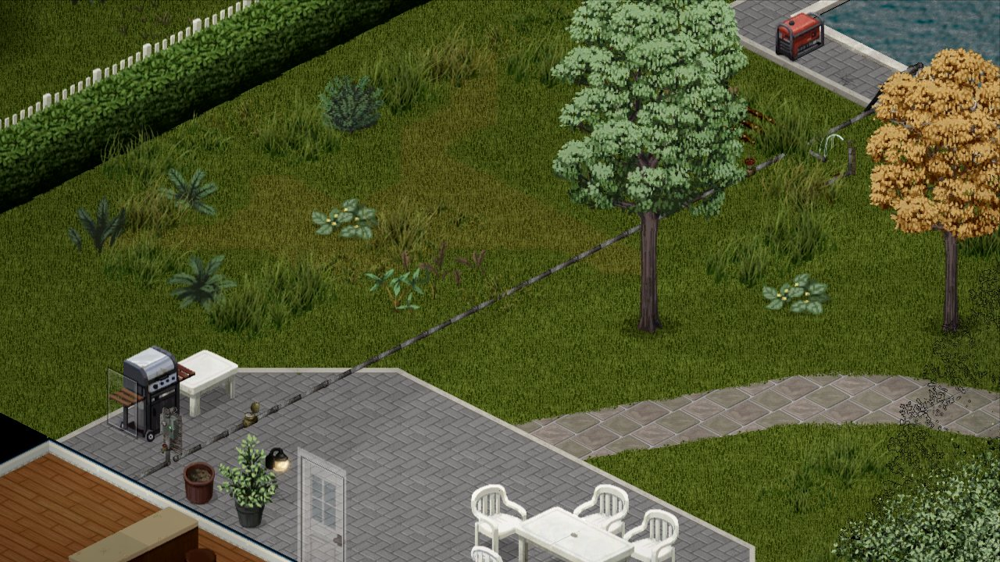
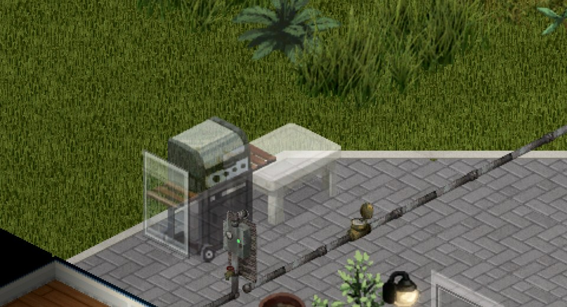
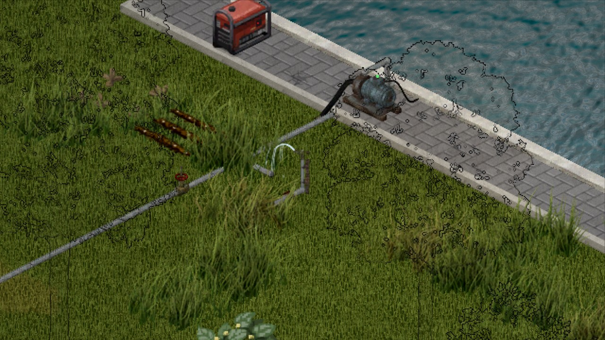
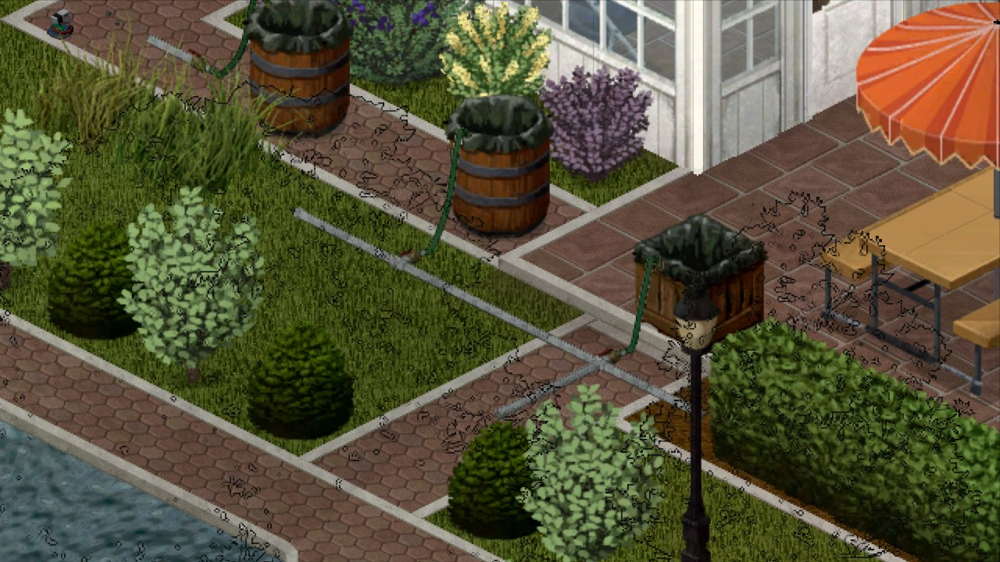
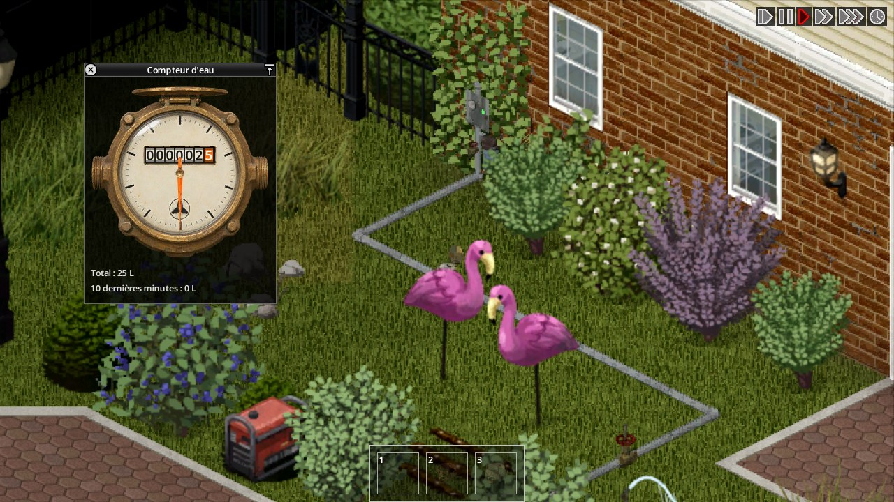

# Premiers pas

Un réseau LiveWater a toujours la même forme : une **source** (une pompe d'étang au bord de l'eau, ou un baril), des
**tuyaux** posés au sol, et des **sorties** au bout (une arrivée d'eau de maison, des arroseurs, des lignes de
goutte-à-goutte, des barils à remplir). L'eau avance toutes les 10 minutes de jeu.

Chaque action d'un menu de LiveWater vous fait marcher jusqu'à la pièce et dure quelques secondes, comme les actions
du jeu.

## 1. Couper des tuyaux d'eau

Un tuyau d'eau couvre une case. Recette **Couper des sections de tuyau** : 1 tuyau en métal, avec une scie à
métaux (gardée), donne **4 tuyaux d'eau**.

> Capture à faire : la recette « Couper des sections de tuyau » dans la fenêtre d'artisanat.

## 2. Fabriquer la pompe d'étang

Recette **Fabriquer une pompe d'étang** (Électricité 2) : 1 tuyau en métal, 2 petites plaques en métal, 3 pièces
électroniques, 2 fils électriques, 4 vis, avec un tournevis et une clé à molette (gardés). Elle donne une pompe d'étang
(15 kg) et 15 XP d'Électricité.

Posez-la comme un meuble (clic droit dans l'inventaire, Placer) **juste au bord d'une eau naturelle** : lac, étang,
rivière, ou contre un puits (voir [Puits](#13-puits)). Ailleurs, le curseur passe au rouge : *Doit être posée au bord
d'une eau naturelle*.

La pompe a besoin de **courant** : un générateur ou le réseau public sur sa case, ou LiveWire (voir
[LiveWire](04-livewire.md)). Elle donne **50 L toutes les 10 minutes** tant qu'une sortie a besoin d'eau, et s'arrête
seule sinon. Une pompe allumée et alimentée ronronne, même sans demande d'eau ; ce bruit n'attire les zombies que lorsqu'elle pompe.

Son menu au clic droit :

- **Allumer la pompe** / **Éteindre la pompe** : l'interrupteur, en plus de l'arrêt automatique.
- **Informations** : un écran LCD rétroéclairé : état (en marche, en attente, éteinte, sans courant, en panne), débit
  possible, débit des 10 dernières minutes, total pompé depuis la pose, rendement, source. L'écran se met à jour
  pendant qu'il est ouvert.
- **Réparer la pompe** : voir plus bas.

**Usure.** Son rendement baisse quand elle tourne (environ une semaine de marche de 100 % à 0 % avec les réglages par
défaut), et le débit suit. Sous 20 %, elle peut tomber en panne ; à 0 %, elle s'arrête. Éteignez-la, puis réparez-la
avec **2 ferrailles** et une **clé à molette** : rendement remis à 100 %.

Une pompe a 4 départs : jusqu'à 4 tuyaux peuvent en partir. Sa pression suffit pour **une maison et quatre arroseurs**
(une arrivée d'eau compte 2, un arroseur ou un baril à remplir compte 1, toutes les lignes de goutte-à-goutte du
réseau comptent 1 ensemble).

**Pendant votre absence.** Votre réseau d'eau continue de tourner quand vous vous éloignez : la pompe puise toujours
dans sa mare ou son puits, les arroseurs ouverts et les lignes de goutte-à-goutte arrosent toujours les cultures, et
les barils en Remplir ou Pomper continuent de se remplir ou de se vider (vous retrouvez la bonne quantité au retour).
L'arrivée d'eau de la maison attend votre retour. Le courant pendant l'absence : avec LiveWire, le réseau qui alimente
la case de la pompe ; sinon le réseau public jusqu'au jour de sa coupure, et un groupe électrogène compte comme au
moment de votre départ (il ne brûle rien entre-temps et reprend sa consommation à votre retour).

## 3. Poser les tuyaux

Un tuyau d'eau se pose comme toutes les autres pièces : clic droit dessus dans l'inventaire, **Placer**, puis
posez-le avec le curseur de meuble. Un tuyau par case. Les tuyaux se raccordent à leurs voisins et prennent seuls leur forme (droit, coude, T, croix).
Les tuyaux restent sur un seul niveau : l'arrivée d'eau porte l'eau aux étages et au sous-sol.

Les tuyaux passent sous les clôtures et les portails (un manchon sombre le montre), mais pas à travers un mur plein ni
une porte. Pour faire entrer l'eau dans un bâtiment, utilisez l'arrivée d'eau de la maison.

Un tuyau posé contre le flanc d'un compteur d'eau ou d'une vanne en ligne ne s'y raccorde pas : ces pièces n'ont que
deux côtés, sur l'axe où elles ont été posées.

**Vue du réseau.** Clic droit sur une pièce : **Afficher le réseau d'eau** colore tout le réseau (tuyaux et pompes en
bleu, sorties selon leur état, et les appareils de la maison qu'elles alimentent ; voir [Diagnostic](03-diagnostic.md)).
**Masquer le réseau d'eau** l'éteint ; les deux options ne s'affichent jamais ensemble.

Pour reprendre un tuyau, ramassez-le comme les autres pièces, avec une **clé**. Le tuyau vous est rendu.

## 4. Vannes

**Vanne d'arrêt.** Recette **Fabriquer une vanne d'arrêt** : 1 tuyau d'eau, 1 ferraille, avec une clé anglaise
(gardée). Posez-la au curseur de meuble sur une case vide entre deux tuyaux d'une ligne droite (elle prend la place
d'un tuyau : ramassez d'abord ce tuyau) ; elle se tourne seule dans le sens du tuyau. Elle se pose
ouverte. Clic droit dessus : **Fermer la vanne** coupe l'eau de tout ce qui est après elle (la maison, les arroseurs
plus loin), **Ouvrir la vanne** la laisse repasser ; son volant montre l'état, et **Informations** le dit aussi. Elle
se ramasse à la clé comme les autres pièces.

Chaque arroseur a aussi sa vanne (**Ouvrir la vanne** / **Fermer la vanne**). Une vanne fermée ne laisse passer aucune
eau, et le diagnostic le dit (*une vanne est fermée*). Les arroseurs se posent fermés.

La vanne en ligne garde son axe quand on l'ouvre ou la ferme. Ouvrir ou fermer une vanne, en ligne ou d'arroseur, fait
un bruit de vanne, entendu des joueurs proches.

## 5. Arrivée d'eau de la maison

Recette **Fabriquer une arrivée d'eau de maison** : 2 tuyaux d'eau, 1 petite plaque en métal, 4 vis, avec une clé
anglaise (gardée).

Posez-la **contre le mur extérieur** d'un bâtiment de la carte, et amenez-y un tuyau depuis la pompe. Elle alimente les
**éviers, baignoires, douches, toilettes et lave-linge** de ce bâtiment que vous avez raccordés à la clé anglaise
(l'action « Raccorder » du jeu), dans un rayon de **20 cases** (option sandbox), jusqu'à **3 étages au-dessus** et
**2 niveaux de sous-sol** en dessous.

Son voyant dit ce qu'elle fait :

- **vert** : eau propre, la maison la reçoit (une cartouche en état dans l'arrivée d'eau, ou de l'eau de puits) ;
- **ambre** : l'eau n'est **pas filtrée**, la maison n'en reçoit **pas** (montez un filtre dans l'arrivée d'eau,
  remplacez une cartouche usée, ou pompez dans un puits).

Un point d'eau déjà alimenté par autre chose (une pompe de LiveWire, un baril au-dessus) est laissé tel quel.

Un évier, une douche, une baignoire, des toilettes ou un lave-linge alimenté par l'arrivée d'eau affiche dans son menu
clic droit l'eau qu'il contient, par exemple une ligne grisée **Eau : 18 L / 25 L**.

## 6. Cartouche filtrante

L'eau d'un étang ou d'une rivière n'est pas propre. Recette **Fabriquer une cartouche filtrante** : 2 charbons de bois
et 2 tissus déchirés donnent une **cartouche filtrante**. Elle nettoie environ **500 L** ; son état montre ce qui reste.

Le filtre se monte dans l'**arrivée d'eau de la maison** : clic droit dessus, **Monter la cartouche filtrante**,
**Remplacer la cartouche filtrante** ou **Retirer la cartouche filtrante**. Une cartouche retirée garde son usure ; une
cartouche usée est jetée. L'arrivée d'eau montre le boîtier du filtre sous son coffret. Il ne nettoie que l'eau qui
entre dans la maison : arroseurs, lignes de goutte-à-goutte et barils prennent l'eau du réseau telle quelle et n'usent
jamais la cartouche.

## 7. Arroseurs

**Arroseur manuel.** Recette **Fabriquer un arroseur** : 2 tuyaux d'eau, 1 ferraille, 1 planche, avec une clé
anglaise (gardée). Posez-le comme un meuble et alimentez-le par un tuyau. Clic droit : **Ouvrir la vanne**. Sa manette se lit d'un coup d'œil : le long du tuyau quand
il est ouvert, en travers quand il est fermé. Tant que
sa vanne est ouverte, il arrose **10 L toutes les 10 minutes**, que les plantes aient soif ou non. Les plantes vivantes
qui ont besoin d'eau dans le **carré de 5 × 5 cases** autour de lui (2 cases de chaque côté ; l'option sandbox change
cette portée) en prennent des doses de 200 ml, les plus proches d'abord ; le reste est perdu. Toute eau convient,
propre ou non. Fermez-le une fois le potager arrosé : resté ouvert, il vide votre baril ou fait tourner votre pompe.

Pour voir les cases arrosées, faites un clic droit sur un arroseur ou une ligne de goutte-à-goutte : **Afficher toutes
les zones arrosées** éclaire en bleu le sol de chaque case arrosée par les arroseurs et les lignes à moins de 25 cases de
vous ; **Masquer la zone arrosée** l'éteint ; une seule des deux options est proposée à la fois. Leur **Information** donne leur débit : combien de litres elles prennent
toutes les 10 minutes (et, pour un arroseur, combien arrivent aux plantes).

Un arroseur qui arrose montre un jet d'eau animé qui fait tout le tour (option du mod *Jet des arroseurs animé* :
décochez-la pour un jet fixe sur un ordinateur lent). Un quart de son eau se perd en l'air : sur 10 L, 7,5 L peuvent
aller aux plantes. Une pompe d'étang (50 L toutes les 10 minutes) alimente au plus cinq arroseurs ouverts à plein
débit ; les suivants reçoivent le reste, puis rien. Il n'est pas discret non plus : on l'entend arroser, et **les
zombies l'entendent** toutes les 10 minutes tant qu'il arrose. Pour un potager silencieux et économe en eau, prenez des
[lignes de goutte-à-goutte](#8-lignes-de-goutte-à-goutte).

**Arroseur automatique.** Recette **Ajouter une minuterie à un arroseur** (Électricité 2) : 1 arroseur, 2 pièces
électroniques, 1 fil électrique, avec un tournevis (gardé) ; 10 XP d'Électricité. Il s'ouvre seul **toutes les
6 heures** et arrose pendant **30 minutes** (10 L toutes les 10 minutes), puis se referme. Changez l'intervalle au clic droit, **Minuterie d'arrosage**, de 1 à
24 heures (bornes dans les options sandbox). La minuterie a besoin d'un peu de courant (5 W : générateur, réseau public
ou LiveWire) ; sans courant elle ne fait rien, mais vous pouvez toujours ouvrir la vanne à la main. Un voyant vert de la minuterie s'allume pendant l'arrosage.

## 8. Lignes de goutte-à-goutte

Une ligne de goutte-à-goutte est un fin tuyau brun posé au sol entre vos rangs. Elle arrose les plantes juste à côté
d'elle, sans bruit et sans gaspiller d'eau.

**La fabriquer.** Recette **Fabriquer des lignes de goutte-à-goutte** (Agriculture) : 1 tuyau en caoutchouc et
2 utilisations de ruban adhésif, avec un couteau tranchant (gardé), donnent **4 lignes de goutte-à-goutte**. Une ligne
couvre une case.

**La poser** comme un tuyau : clic droit dessus dans l'inventaire, **Placer**, une par case. Les lignes se raccordent
entre elles et aux tuyaux d'eau et changent de forme toutes seules. On la ramasse à la main, sans outil.

**Ce qu'elle arrose.** Toutes les 10 minutes, chaque case de la ligne prend **0,5 L** au réseau et arrose les cases
voisines qui ne font pas partie de la ligne, par doses de 200 ml. Une ligne droite arrose les cases des deux côtés ; la
case sous le tuyau n'est pas arrosée. Posez donc la ligne dans une allée entre deux rangs de cultures. Rien ne se perd
en l'air ; ce dont les plantes n'ont pas besoin s'infiltre dans le sol. Elle goutte dès que le réseau lui donne de
l'eau : une [vanne](#4-vannes) placée avant elle l'arrête. Une ligne au bout d'un réseau à court de
pression reste à sec.

**Ce qu'il lui faut.**

- **N'importe quelle eau.** Propre ou non, sans filtre. L'essence et tout autre fluide sont refusés.
- **Peu de pression.** Toutes les lignes d'un réseau comptent **1** ensemble, quel que soit leur nombre.
- **Pas besoin de pompe.** Raccordez un baril par un [raccord de baril](#9-raccord-de-baril--remplir-ou-pomper) réglé
  sur **Pomper** : sans pompe sur le réseau, le poids du baril pousse son eau dans les lignes, eau de pluie ou
  d'étang. Cette faible pression ne suffit qu'aux lignes de goutte-à-goutte : un arroseur ou une arrivée d'eau sur
  ce réseau ne reçoivent rien.

Une ligne de goutte-à-goutte ne fait aucun bruit.

## 9. Raccord de baril : Remplir ou Pomper

Recette **Fabriquer un raccord de baril** : 1 tuyau d'eau, 1 tuyau en caoutchouc, avec une clé anglaise (gardée).
Posez-le entre le bout d'un tuyau et un baril ou un récupérateur d'eau de pluie, ou au milieu d'une ligne de tuyaux : il
laisse alors passer l'eau d'un tuyau à l'autre. Son dessin suit les tuyaux voisins (droit, coudé, en té ou en croix) ; le
baril, quand il y en a un, reste derrière lui. Clic droit :

- **Régler sur Remplir** : les tuyaux remplissent le baril, jusqu'à 50 L toutes les 10 minutes, sans jamais déborder.
  Le baril reçoit toujours de l'**eau croupie**, même depuis un puits : les tuyaux transportent de l'eau non traitée,
  seule l'arrivée d'eau de la maison donne de l'eau propre. Une fontaine à eau se remplit de la même façon.
- **Régler sur Pomper** : la pompe du réseau tire le contenu du baril au lieu de son étang. Sans pompe sur le réseau,
  le baril alimente les [lignes de goutte-à-goutte](#8-lignes-de-goutte-à-goutte) par son propre poids.

Son dessin suit le mode, la forme du récupérateur et les tuyaux voisins. **Informations** montre le mode et les litres du baril.

**Essence.** Un raccord réglé sur Pomper contre un baril d'essence ou une pompe de station-service fait un réseau
d'essence. Il ne remplit que des barils (vides, ou contenant déjà de l'essence) par des raccords réglés sur Remplir.
Arrivées d'eau et arroseurs ne reçoivent rien et le disent.

## 10. Barils raccordés à la maison

Pas de pompe ? Clic droit sur un récupérateur d'eau de pluie ou un baril posé **dans la maison ou sur son toit** :
**Raccorder à l'arrivée d'eau de la maison** (avec une clé anglaise). Aucun tuyau n'est nécessaire, seulement une
arrivée d'eau sur ce bâtiment.

- Un baril alimente **son étage et ceux du dessous** (gravité). Avec une pompe dans le réseau de l'arrivée d'eau, ou du
  courant sur la case du baril, il alimente tous les étages.
- Tous les barils raccordés se vident **ensemble**. **Garder en réserve (pris en dernier)** en met un de côté : il
  n'est utilisé qu'une fois les autres vides. **Utiliser avec les autres barils** le remet avec eux.
- Un baril vide reste raccordé. Un baril qui contient autre chose que de l'eau ne donne rien tant qu'il n'est pas vidé.
- **Débrancher de l'arrivée d'eau de la maison**, ou emportez le baril : il n'est plus raccordé.

## 11. Réseau public

Tant que l'eau de la ville coule, clic droit sur un évier, une baignoire, une douche, des toilettes ou un lave-linge
**que vous avez posé** dans une pièce d'un bâtiment de la carte : **Raccorder au réseau public**. Il se comporte alors
comme un point d'eau d'origine : eau illimitée jusqu'à la coupure de l'eau de la ville.

## 12. Compteur d'eau

Recette **Fabriquer un compteur d'eau** : 1 tuyau d'eau, 1 petite plaque en métal, 2 vis, avec un tournevis
(gardé). Posez-le en ligne sur un tuyau ; il suit le sens du tuyau et ne se raccorde qu'à ses deux côtés, sur cet axe.

**Informations** ouvre une fenêtre de compteur d'eau, à la manière d'un compteur américain : un totalisateur à rouleaux
(les litres passés depuis la pose), une aiguille de balayage (un tour toutes les 10 litres), les litres des 10 dernières
minutes et la qualité de l'eau (propre, non filtrée ou essence). Le total est gardé quand on ramasse le compteur et qu'on
le repose ; il n'y a pas de remise à zéro.

## 13. Puits

La même pompe d'étang posée contre un **puits** tire de l'**eau propre** : la maison la reçoit sans filtre. Ses
informations disent *Source : puits (eau propre)*.

> Capture à faire : une pompe d'étang contre un puits.

## 14. Démonter une pièce

Chaque pièce LiveWater se démonte dans l'inventaire, par une recette **Démonter ...** (fenêtre d'artisanat,
Assemblage ou Électricité) : une clé à tuyau ou une clé pour les pièces de plomberie (tuyau, vanne, compteur, arrivée
d'eau, arroseur, raccord de baril), un tournevis pour la pompe d'étang et l'arroseur automatique, un couteau pour une
ligne de goutte-à-goutte ou une cartouche filtrante. On ne récupère jamais plus que ce que la pièce a coûté, et
seulement des débris : morceaux de fer, ferraille, vis, ferraille électronique, fil. Une cartouche filtrante rend un
morceau de tissu, une ligne de goutte-à-goutte un élastique.

Une pièce posée se démonte aussi sur place, par le menu **Démonter** du jeu et avec le même outil (l'Entretien augmente
vos chances pour les pièces de plomberie, l'Électricité pour la pompe et l'arroseur automatique). Elle quitte le réseau
comme si vous l'aviez ramassée. Une ligne de goutte-à-goutte se ramasse à la main, puis se démonte dans l'inventaire.

## 15. Trouver des pièces

Certaines pièces se trouvent au lieu de se fabriquer, rarement : tuyaux d'eau, vannes d'arrêt et raccords de baril
dans les fournitures de plomberie et les caisses à outils ; arroseurs, lignes de goutte-à-goutte et cartouches
filtrantes dans les jardineries et le matériel agricole. La pompe d'étang, l'arrivée d'eau, le compteur et l'arroseur
automatique ne se trouvent jamais : on les fabrique.

Suite : [Base du joueur](02-base-du-joueur.md) · [Diagnostic](03-diagnostic.md)
