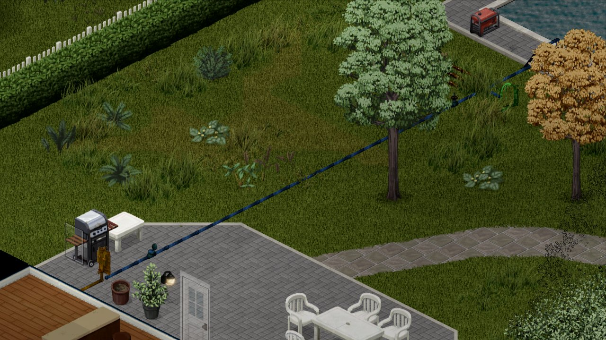
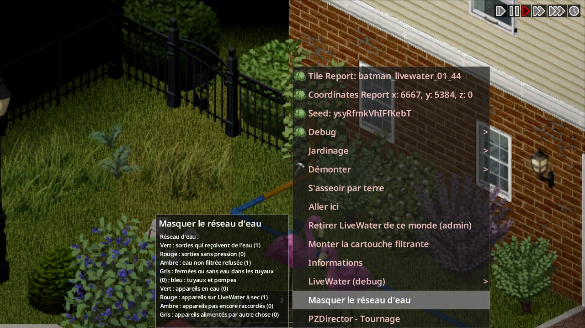

# Diagnostic

## Vue du réseau

Clic droit sur une pièce d'un réseau (tuyau, pompe, arrivée d'eau, arroseur, raccord) : **Afficher le réseau d'eau**.
Tout le réseau reste en surbrillance jusqu'à **Masquer le réseau d'eau** :

| Couleur | Sens |
|---|---|
| vert | sorties qui reçoivent de l'eau |
| rouge | sorties sans pression suffisante |
| ambre | sorties qui refusent l'eau non filtrée (arrivée d'eau sans filtre en état) |
| gris | fermées, ou pas d'eau dans les tuyaux |
| bleu | tuyaux et pompes |

Les appareils de la maison dans la zone de chaque arrivée d'eau du réseau (éviers, douches, baignoires, toilettes,
lave-linge) sont surlignés aussi :

| Couleur | Appareil |
|---|---|
| vert | raccordé à l'arrivée d'eau, avec de l'eau |
| rouge | raccordé à l'arrivée d'eau, mais à sec |
| ambre | pas raccordé (utilisez une clé à tuyau dessus) |
| gris | alimenté par autre chose (baril au-dessus, pompe de LiveWire) |

L'infobulle de *Masquer le réseau d'eau* compte les sorties et les appareils de chaque état.

## Informations

**Informations** au clic droit d'une pièce montre ce qu'elle fait :

- pompe : un écran LCD rétroéclairé avec l'état, le débit possible, le débit des 10 dernières minutes, le total
  pompé, le rendement et la source (eau naturelle ou puits) ;
- arrivée d'eau : filtre restant (ou aucun, ou usé) ;
- arrivée d'eau : *livrée à la maison*, *les réservoirs de la maison sont pleins*, *aucune dans les tuyaux*, *non
  filtrée*, *pression insuffisante*, *coupée*, ou *les tuyaux transportent de l'essence* ;
- arroseur : arrose, rien à arroser, pas d'eau, non filtrée (les arroseurs l'acceptent), pas de pression, vanne
  fermée ; l'intervalle de la minuterie et si elle a du courant ;
- raccord de baril : mode (Remplir ou Pomper), litres du baril, et ce qu'il fait ;
- compteur d'eau : total depuis la pose, litres des 10 dernières minutes et qualité, dans une fenêtre de compteur.

## Pourquoi un robinet n'a pas d'eau

Clic droit sur un évier, une baignoire, une douche, des toilettes ou un lave-linge sans eau : une ligne **Pas d'eau :
...** dit pourquoi. Un appareil alimenté par une arrivée d'eau qui a de l'eau montre une ligne grise **Eau : 18 L /
25 L**.

| Raison affichée | Que faire |
|---|---|
| pas encore raccordé | utilisez une clé anglaise dessus (action « Raccorder » du jeu) |
| aucune arrivée d'eau ne le dessert | posez une arrivée d'eau sur ce bâtiment, ou rapprochez-la (portée, étages) |
| son réservoir appartient à autre chose, et il est vide | un autre système (baril au-dessus, pompe de LiveWire) l'alimente |
| l'eau arrive | attendez jusqu'à 10 minutes |
| l'eau n'est pas filtrée : montez un filtre dans l'arrivée d'eau | montez ou remplacez le filtre de l'arrivée d'eau, ou pompez dans un puits |
| pression insuffisante | moins de sorties sur cette pompe, ou une deuxième pompe |
| pas d'eau dans les tuyaux | la pompe est éteinte, en panne ou sans courant |
| une vanne est fermée | ouvrez-la |
| les barils sont plus bas que ce point d'eau | ajoutez une pompe au réseau, ou du courant sur la case du baril |
| les barils sont vides ou contiennent autre chose que de l'eau | remplissez-les ou videz-les |
| l'arrivée d'eau n'a ni pompe ni baril | reliez-y une pompe ou raccordez un baril |
| les tuyaux transportent de l'essence | ce réseau transporte de l'essence, pas de l'eau |

> Capture à faire : le menu au clic droit d'un évier sec, avec sa ligne « Pas d'eau ».

Suite : [LiveWire](04-livewire.md)
