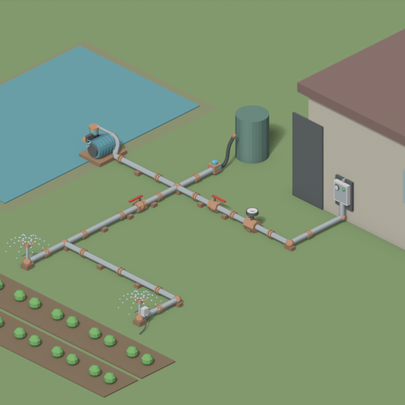
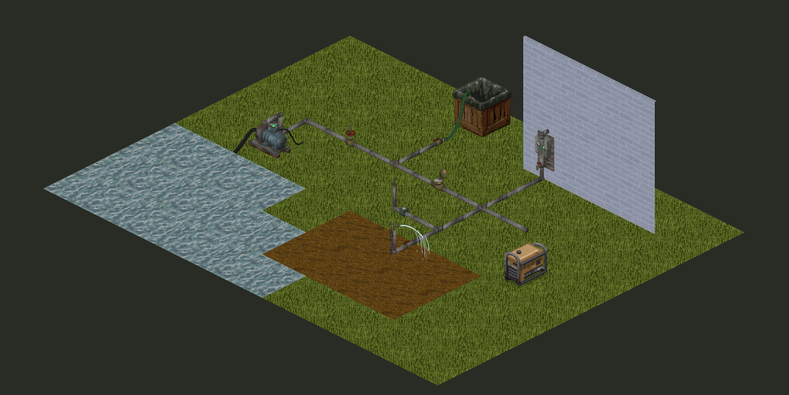

> English version: [Home](../en/Home.md)

# LiveWater

**LiveWater** (id du mod `batman_LiveWater`) est un mod de Project Zomboid **Build 42.22**.
Un jour, l'eau ne coule plus au robinet ; LiveWater vous laisse la ramener vous-même : une pompe d'étang au bord d'un
lac, d'une rivière ou contre un puits, des tuyaux posés au sol, une arrivée d'eau qui alimente éviers, douches,
toilettes et lave-linge, des barils raccordés à la maison, et des arroseurs qui arrosent le potager tout seuls.

LiveWire est facultatif : avec LiveWire, la pompe devient l'un de ses consommateurs. Solo et multijoueur (multijoueur
pas encore testé).

Première fois ? Commencez par [Premiers pas](01-premiers-pas.md).

## Pages

- [Premiers pas](01-premiers-pas.md) : chaque pièce, de la première section de tuyau à l'arroseur automatique.
- [Base du joueur](02-base-du-joueur.md) : l'eau courante dans une base construite par vous.
- [Diagnostic](03-diagnostic.md) : la vue du réseau, les informations et pourquoi un robinet n'a pas d'eau.
- [LiveWire](04-livewire.md) : l'intégration facultative avec LiveWire.
- [Options sandbox](05-options-sandbox.md) : tous les réglages du serveur.
- [Pour les moddeurs](06-pour-les-moddeurs.md) : l'API publique et ses révisions.
- [Retirer le mod](07-retirer-le-mod.md) : comment sortir LiveWater d'un monde.
- [Multijoueur](08-multijoueur.md) : ce qu'il faut savoir sur un serveur.
